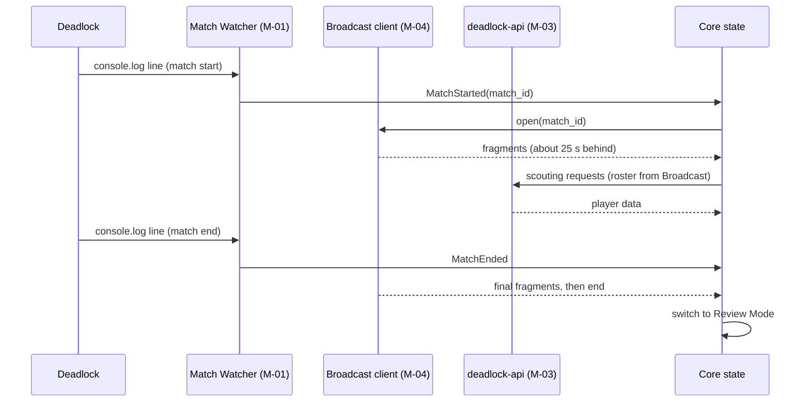

# 04 — Data Sources and Ingestion

## Purpose

Specifies every data source the app uses: how it's read, how often, its limits, and how failures are handled.

## Scope

- Match detection from the console log.
- Account detection.
- The Broadcast client.
- The deadlock-api client and its endpoint catalog.
- Caching, and local Broadcast recording for Review.

## Details

### Source overview

| Source | Gives | When | Latency | Module |
|---|---|---|---|---|
| Game console log (launch option `-condebug`) | Match start, match end, match ID | Live | Seconds | M-01 Match Watcher |
| Local Steam files | The user's Account ID, Steam library paths | Startup | — | M-02 Account |
| Valve Broadcast | Full entity state of the live match | Live | About 25 s behind (DEC-006, DEC-050) | M-04 Broadcast client |
| deadlock-api | Player history, MMR, hero stats, builds, item and hero analytics, game assets | Any time | Cached server-side | M-03 API client |
| GitHub Releases | Latest app version | Startup | — | M-20 Settings (FR-SET-004) |
| Recorded Broadcast or replay `.dem` | Full match data for Review | After the match | — | M-04, M-21 |

### Match Watcher (M-01)

- **Input:** `console.log` written by Deadlock when launched with `-condebug`. The first-run setup tells the user to add it (FR-SET-003).
- **Path:** `<Steam library>/steamapps/common/Deadlock/game/citadel/console.log` [VERIFY] (OQ-03).
- **Steam libraries to search:**
    - Native Steam: `~/.local/share/Steam`, `~/.steam/steam`.
    - Flatpak Steam: `~/.var/app/com.valvesoftware.Steam/.local/share/Steam`.
    - Every library listed in `steamapps/libraryfolders.vdf` under those roots.
    - Windows: `C:\Program Files (x86)\Steam` plus `libraryfolders.vdf`.
- **Method:** Tail the file with the `notify` crate, plus a 1 s poll fallback. Handle truncation when the game restarts.
- **Patterns:** The log lines for match start, match end and match ID aren't known yet. Capture them from real logs in task T-006 and store them as regexes in `DATA-001` config, never hard-coded (OQ-03).
- **Output events:** `Started`, `MatchId(u64)`, `Ended`, `GameExited` ([12](12-programs-and-code.md) PRG-01). The core pairs `Started` with the next `MatchId` to form a match.

### Account (M-02)

- **Primary:** Read `config/loginusers.vdf` under the Steam root, take the entry with `MostRecent = 1`, and convert SteamID64 to Account ID: `account_id = steamid64 − 76561197960265728`.
- **Fallback:** Manual entry of a SteamID64, an Account ID or a profile URL in Settings.
- No Steam Web API calls (NFR-FAIR-005).

### Game mode

The app analyzes Standard-mode matches only (DEC-019). The mode is read from the Broadcast or from API-05 [VERIFY] (OQ-05). Other modes are saved to `matches` with their `game_mode` and get no scouting, live recommendations or Review.

### Broadcast client (M-04)

- **Library:** [haste](https://awesome.ecosyste.ms/projects/github.com%2Fblukai%2Fhaste) (Rust, BSD-3-Clause). It parses Deadlock replays and HTTP broadcasts through its optional `broadcast` feature.
- **Fallback:** [DemoFile](https://nuget.org/packages/DemoFile) (.NET) in a sidecar process (M-21) when haste fails after a game patch (NFR-REL-002).
- **Locating the Broadcast:** How to get the Broadcast URL for a match ID without the app running its own Valve game-coordinator client is unresolved (OQ-02, RSK-11). Candidates, in order of preference:
    1. deadlock-api (chosen, DEC-049). First check the listing `GET /v1/matches/live/urls` (100 req/s per IP). If the match isn't listed, call `GET /v1/matches/{match_id}/live/url` once (6 req/h per IP, 300 req/h globally; deadlock-api spectates the match on its side). Reuse the URL for reconnects.
    2. deadlock-api's live events service ([live.deadlock-api.com](https://live.deadlock-api.com/), $0.50 per match). Not used: it conflicts with NFR-COST-001, and the Upkeep tier is out of v1 scope (DEC-018).
- **Go/no-go gate (DEC-021):** Passed on 2026-11-05 (DEC-049). The roster carries each player's Account ID (`CCitadelPlayerController.m_unEconAccountID`) from the first fragment. Task T-008 had to find a compliant locator before live features are built. It also confirms that the Broadcast roster carries each player's Account ID. If no compliant locator exists, Alpha ships without the Broadcast: scouting from deadlock-api with manual roster entry (FR-DATA-007), and a post-match Review from a downloaded replay (API-17) or a stats-only Review from API-05. The app never implements its own game-coordinator client (RSK-11).
- **Delay:** Every Broadcast-derived value carries `t_game` (game time) and `t_received` (wall time). The UI shows the current delay (FR-UI-008).
- **Recording:** Every Broadcast fragment received for the user's own match is appended to `recordings/<match_id>.bcast` for Review (FR-DATA-005).
- **Reconnect:** Backoff 2, 4, 8, 16, 32 s, then emit `BroadcastLost` (NFR-REL-001).

### deadlock-api client (M-03)

Base URL: `https://api.deadlock-api.com`. The machine-readable spec is at `/openapi.json`.

| ID | Endpoint | Used for | Status |
|---|---|---|---|
| API-01 | `GET /v1/players/{account_id}/match-history` | Last N matches per player | Path verified in a third-party issue; returns cached history |
| API-02 | `GET /v1/players/rank?account_ids=…` (batch) | Current rank only. `/v1/players/mmr` no longer exists and there is no MMR history endpoint; the trend comes from API-01 `ranked_delta` (DEC-051) | Verified in spec (2026-11-05). 20 req/min per IP |
| API-03 | `GET /v1/players/hero-stats` | Per-hero matches and win rate | Path verified in a third-party CLI |
| API-04 | `GET /v1/players/steam` | Display name and avatar | Path verified in a third-party CLI |
| API-05 | `GET /v1/matches/metadata?match_ids=…` (bulk), `GET /v1/matches/{match_id}/metadata?disable_steam=true` (single) | Per-match items with purchase times, `assigned_lane`, `hero_build_id` and `pregame_hero_id` (when demo analysis has them), cumulative `stats[]` every 180 s with `net_worth` and souls by source, objectives. No party ID | Verified (T-009, DEC-053). Bulk: 30 req/min per IP, up to 1,000 IDs per call |
| API-06 | `GET /v1/analytics/hero-build-stats/{hero_id}?account_ids=…` | Which builds a player selects at game start | Verified in spec |
| API-07 | `GET /v1/analytics/item-stats` (`hero_ids`, `enemy_hero_ids`, `same_lane_filter`, `bucket`, badge filters) | Counter-item scores, item timing | Verified in spec |
| API-08 | `GET /v1/analytics/item-flow-stats` | Per-phase item transitions, adjusted win rate | Verified in spec |
| API-09 | `GET /v1/analytics/hero-counter-stats?account_ids=…` | User's record against enemy heroes | Verified in spec |
| API-10 | `GET /v1/analytics/hero-synergy-stats?account_ids=…` | User's record with teammates' heroes | Verified in spec |
| API-11 | `GET /v1/analytics/ability-max-first-stats?account_ids=…` | Which ability a player maxes first | Verified in spec |
| API-12 | `GET /v1/analytics/hero-stats` (`account_ids`, `min_hero_matches_total`, badge filters) | Benchmarks and experience | Verified in spec |
| API-13 | `GET /v1/analytics/hero-ban-stats` | Match-level ban rates (FR-SCOUT-016) | Verified in spec |
| API-14 | `GET /v1/analytics/hero-swap-stats` | Baseline swap rates | Verified in spec |
| API-15 | `GET /v1/assets/heroes`, `/v1/assets/items`, `/v1/assets/ranks` | Game data and icons | Referenced in spec |
| API-16 | `GET /v1/builds?hero_id=…&only_latest=true` | In-game builds (FR-BUILD-001). Don't use `/v1/builds/{hero_id}/{build_id}`: it can trigger a game-coordinator fetch on deadlock-api's side | Verified (T-009, DEC-053). 100 req/s per IP |
| API-18 | Team comp win-rate prediction (the source behind deadlock-api's team builder) | Team comp prediction (FR-LIVE-016) | Path [VERIFY]; the team builder page documents no endpoint. Fallback: global hero counter and synergy stats (API-09 and API-10 without `account_ids`) |
| API-17 | Replay file URL for a match | Downloading a replay when the recording is missing (FR-DATA-009) | Path [VERIFY]. If it needs Valve-side data, treat it like the locator (OQ-02) and drop it if non-compliant |

#### Rate limits

| Scope | Limit | Source |
|---|---|---|
| Analytics endpoints (shared) | 200 req/min per IP. With a key: 400 req/min and 2,500 req/h. Global: 2,000 req/min | [openapi.json](https://api.deadlock-api.com/openapi.json) |
| Match history | 100 req/s per IP. `force_refetch=true` is limited to 1 req/h per IP (5 with a key) | [DeadBase issue #27](https://github.com/EdwardGlockner/DeadBase/issues/27) |
| Per-endpoint limits (2026-11-05 spec) | API-05 bulk 30 req/min; API-02 rank batch 20 req/min; live URL 6 req/h (DEC-049). Each gets its own bucket at 80% in DATA-001 (DEC-053) | [openapi.json](https://api.deadlock-api.com/openapi.json) |
| Load shedding | `503` with `Retry-After` when busy; `504` on timeout, then fails fast for a few minutes | [openapi.json](https://api.deadlock-api.com/openapi.json) |

#### Client rules

- One token bucket per limit scope, set to 80% of the published limit [ASSUMPTION].
- Honor `Retry-After` on `503` and `504`. Never retry a `504` request with the same parameters within 5 minutes.
- Never use `force_refetch` for other players.
- No API key ships in the app. A user may enter their own key in Settings (NFR-COST-001) [ASSUMPTION].
- Set `User-Agent: stalemate/<version> (+https://github.com/HatchBear/Stalemate)`. Never include the user's email.

#### Request budget per match

| Call | Count | Scope |
|---|---|---|
| API-01, API-02, API-03 for 11 players | 33 | Non-analytics |
| API-06, API-11 for 11 players | 22 | Analytics |
| API-05 for the last 30 matches on the current hero × 11 players, batched in one call per player (up to 1,000 IDs per call) | 11 | Metadata bucket, 24/min (DEC-053). The Build Profile and Playstyle share this sample |
| API-12 for Playstyle percentiles, one per player and hero | 11 | Analytics (Beta) |
| API-07 lift lookups `L(i, e)` for the Counter-buy filter | Lazy: only for candidate counter items, cached by (hero, enemy hero, patch) | Analytics (Beta) |
| API-07, API-08 for counter items, refreshed on enemy purchases (max 1 per 30 s) | ≤ 2 per min | Analytics |
| API-09, API-10 for the user | 2 | Analytics |
| API-18, or API-09 and API-10 without `account_ids`, for the two teams | ≤ 3, once per match | Analytics (Beta) |

Scouting fills progressively (DEC-022). The basic card fields come first from API-01 to API-03 (33 non-analytics calls). The Build Profile, Power spikes and Playstyle follow as the analytics bucket allows. SM-2 applies to the basic fields only. Without lift lookups, the first-minute analytics calls are 22 + 11 + 2 + 2 = 37, well under the 160/min bucket (`analytics_per_min`). Lift lookups use the remaining capacity and are cached for the whole patch, so repeat heroes cost nothing.

### Caching

| Data | TTL | Store |
|---|---|---|
| Game assets (API-15) | Until the patch changes | `api_cache` + `assets/` |
| Player history (API-01, API-02, API-03) | 6 h | `api_cache` |
| Match metadata (API-05) | Forever (matches are immutable) | `matches` tables |
| Analytics (API-06 to API-14) | 24 h, keyed by the full query string | `api_cache` |
| Counter-buy lift lookups (API-07 by hero and enemy hero) | Until the patch changes | `api_cache` |

Schema: [11](11-data-model.md).

### Data flow

## Dependencies

- [03 Fair play](03-fair-play-and-compliance.md)
- [10 Architecture](10-technical-architecture.md): M-01 to M-04, M-21.
- [11 Data model](11-data-model.md)
- [12 Programs](12-programs-and-code.md): PRG-01 to PRG-04, PRG-21.
- [14 Data assets](14-data-and-content-assets.md): DATA-001.

## Open Questions

- OQ-02: How is the Broadcast URL obtained? (Blocking for FR-DATA-003.)
- OQ-03: What is the exact `console.log` path, and which log lines mark match start, match end and match ID?
- OQ-05: Which fields does API-05 return (purchases, selected build, pre-swap hero, party, per-minute stats), and what's its batch limit?
- OQ-07: What's the path of API-16 (community builds)?
- OQ-18: What's the path of API-17 (replay URL), and does it need Valve-side data?
- OQ-20: What endpoint and data shape does the team comp prediction (API-18) use?
- [ASSUMPTION] Token buckets at 80% of published limits.
- [ASSUMPTION] No bundled API key.

## Acceptance Criteria

- [ ] Match start and end are detected within 5 s in 20 of 20 test matches (TST-010).
- [ ] The client never exceeds a published limit in a 1-hour soak test (TST-013).
- [ ] A dropped Broadcast reconnects or reports `BroadcastLost` per NFR-REL-001 (TST-012).
- [ ] Every [VERIFY] item is resolved and this doc is updated.
