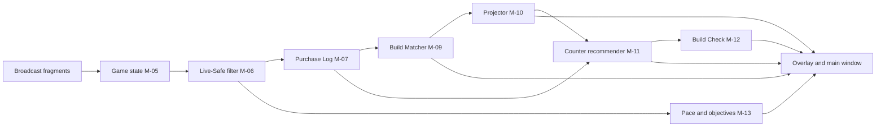

# 06 — In-Match Recommendations

## Purpose

Specifies Live Mode: the enemy board, Purchase Log, Build Matcher, Projector, counter-item recommender, Build Check, pace, flex slots and timers.

## Scope

- **Covers:** FR-LIVE-001 to FR-LIVE-016.
- **Data rule:** Everything here runs on Live-Safe fields only ([03](03-fair-play-and-compliance.md)) plus historical public data.

## Details

### Pipeline

All Live Mode values carry `t_game`. The UI shows the Broadcast delay (FR-UI-008).

### Enemy board (FR-LIVE-001)

One row per enemy, showing:

- Hero (LS-01) and name (LS-02).
- Items (LS-04).
- KDA (LS-06) and level (LS-07), once verified.
- Detected build and confidence (FR-LIVE-003).
- Projected next 3 items (FR-LIVE-004).

### Purchase Log (FR-LIVE-002)

- **Source:** Inventory changes per player between consecutive Broadcast ticks.
- **Event:** `{ t_game, account_id, item_id, action: Buy | Sell | Upgrade, cost }`.
- **Upgrades:** When a component disappears in the same tick that an item it builds into appears, record one `Upgrade` event, not a `Sell` plus a `Buy` [ASSUMPTION about the item-tree data in API-15].
- **Storage:** Kept in memory for the match and saved to `purchase_events` ([11](11-data-model.md)).
- **Uses:**
    - Build Matcher input.
    - Threat weights in counter scoring.
    - Triggers a recommendation refresh on every enemy `Buy` or `Upgrade` (FR-LIVE-008, DEC-015).
    - The Review's build analysis ([07](07-post-match-review-engine.md)).

### Build Matcher (FR-LIVE-003)

**Candidates** for enemy *p* on hero *h*:

- The top 50 community builds for *h* by usage at the match's rank range (API-06 global).
- Every build *p* has selected on *h* historically (API-06 with `account_ids=[p]`).

**Prior:**

- `P(b) = 0.7 × P_player(b) + 0.3 × P_global(b)` when *p* has at least 10 matches on *h*.
- Otherwise `P(b) = P_global(b)`.

**Likelihood:** For each item *i* currently owned by *p* (counting an upgraded item as also covering its components):

- `P(i | b) = 0.90` if *i* is in build *b*.
- `P(i | b) = 0.05` otherwise.
- Items in *b* that *p* doesn't own yet are ignored, because builds fill in over time.

**Posterior:** `P(b | items) ∝ P(b) × Π P(i | b)`, normalized over the candidates.

**Output:**

- The top build and its posterior as confidence.
- If confidence < 0.40, show "Unclear" with the top 2 candidates.
- Recompute on each Purchase Log event for *p*.

All constants are [ASSUMPTION] and live in DATA-001. Accuracy target: SM-3.

### Projector (FR-LIVE-004)

For each enemy, the next 3 items are ranked by:

`score(j) = 0.6 × order_score(j) + 0.4 × T(j | last item, phase)`

- `order_score(j)` = 1 for the next unbought item in the top build's order, decreasing by 0.2 per position.
- `T(j | i, phase)` = transition probability from item *i* to item *j* in the current phase, from API-08 (phases: 0–9, 9–20, 20–30 and 30+ min).

### Counter-item recommender (FR-LIVE-005 to FR-LIVE-008)

**Candidates:** Shop items the user doesn't own, with cost ≤ the user's current souls (LS-12) plus 2 minutes of income at the user's current souls-per-minute.

**Target set E:**

| Phase | Game time | E | API-07 filters |
|---|---|---|---|
| Lane | 0:00–8:59 | The user's lane opponents (LS-09) | `same_lane_filter=true` |
| Team | 9:00 and later | All 6 enemies | `same_lane_filter=false` |

If LS-09 is still unverified, use E = all enemies during the Lane phase too, and label the list "Team" [ASSUMPTION].

**Threat weight** for enemy *e*:

- `value(e)` = total cost of items owned (Purchase Log) plus 0.5 × total cost of their projected next 3 items.
- `w_e = value(e) / Σ value`.

**Score** for candidate *i*, with user hero *h* and badge range ±1 tier of the match:

- `lift(i, e) = WR(i | hero h, enemy e) − WR(i | hero h)`, both from API-07 with the same filters.
- `counter(i) = Σ over e in E of w_e × lift(i, e)`.
- `Score(i) = AdjWR(i, phase) + counter(i)`, where `AdjWR` is API-08's adjusted win rate for *i* in the current phase column (FR-LIVE-007).
- Exclude *i* if any `lift(i, e)` is based on fewer than 200 matches.

**Output:**

- Top 5 by `Score` in the main window; top 3 in the overlay.
- Each entry shows the item, its score change against the baseline in percentage points, and the enemies driving it.

**Refresh:**

- On each enemy `Buy` or `Upgrade`, at most once per 30 s.
- At the 9:00 phase switch.
- API-07 results are cached 24 h per (hero, enemy, badge range, lane filter), so most refreshes are cache hits.

**History (FR-LIVE-014):** Every time the top 3 changes, append `{ t_game, items, drivers }` to `recommendation_history`. The main window lists the full history for the match.

### Build Check (FR-LIVE-009)

1. For each item *k* in the user's active Build plan ([08](08-builds-import-and-builder.md)) that isn't owned yet, compute `Score(k)`.
2. For each recommended item *i* of the same shop category (weapon, vitality or spirit), suggest swapping *k* for *i* if `Score(i) − Score(k) ≥ 0.02`.
3. Show at most 2 swap suggestions at a time. The overlay shows only the top one.

### Team comp prediction (FR-LIVE-016)

- **What it shows:** The predicted win rate for the user's team, with the rank range it applies to, in the main window Live view. It isn't shown in the overlay, because the panel set OV-1 to OV-5 is fixed.
- **When:** Computed once when the roster arrives. Hero picks are fixed by then, because scouting only starts after the pre-game swap phase closes (FP-10, DEC-023). Cached 24 h per rank range.
- **Inputs:** Heroes (LS-01), teams (LS-03), assigned lane (LS-09, only once verified; without it, lane matchups are skipped) and public historical stats (LS-14). It uses no net worth, items or other non-Live-Safe fields.
- **Source:** Preferred is the deadlock-api prediction behind its team builder (API-18, [VERIFY]). The fallback combines global hero counter and synergy stats (API-09 and API-10 queried without `account_ids`, [VERIFY]) with lane matchups into a team win rate. The combination formula is defined once the data shape is known (OQ-20).
- **Label:** The panel says the number is based on hero picks only.

### Pace and objectives (FR-LIVE-010 to FR-LIVE-013)

| Feature | Rule | Source |
|---|---|---|
| Farm pace | The user's souls per minute against the median for their hero at their rank. Show the difference as a percentage | LS-12, API-12 [VERIFY field] |
| Item timing | The next core item in the Build plan against the rank median purchase time. Ahead or behind if more than 60 s off | API-07 with `bucket=game_time_min` |
| Flex slots | Objectives still needed for the user's team's next flex slot | LS-11, LS-13, DATA-002 rules [VERIFY] |
| Timers | Reminders at fixed match-clock times from DATA-002 | LS-10, DATA-002 [VERIFY values] |

### Overlay vs main window

| Info | Overlay (currently needed) | Main window (good to know) |
|---|---|---|
| Top counter items | Top 3 | Top 5, with drivers |
| Build swap suggestion | Top 1 | Up to 2 |
| Pace and item timing | One line | Full detail |
| Timers and flex slot | Next one only | All |
| Broadcast delay | Yes | Yes |
| Enemy board, Purchase Log | — | Yes |
| Build Matcher and Projector | — | Yes |
| Past recommendations | — | Full history (FR-LIVE-014) |
| Team comp prediction | — | Yes (FR-LIVE-016) |
| Scouting Cards | — | Yes |

### Not done in Live Mode

- Fight tracking or analysis (FR-LIVE-015).
- Showing any non-Live-Safe field ([03](03-fair-play-and-compliance.md)).
- Buying or clicking anything (NFR-FAIR-002).

## Dependencies

- [03 Fair play](03-fair-play-and-compliance.md)
- [04 Data sources](04-data-sources-and-ingestion.md)
- [05 Scouting](05-player-scouting.md): Build Profiles feed the Build Matcher prior.
- [08 Builds](08-builds-import-and-builder.md): Build plan.
- [09 UI](09-ui-window-and-overlay.md)
- [12 Programs](12-programs-and-code.md): PRG-05 to PRG-07, PRG-10 to PRG-14.
- [14 Data assets](14-data-and-content-assets.md): DATA-001, DATA-002.

## Open Questions

- OQ-04: Is LS-09 (enemy lane) Live-Safe? This decides whether Lane-phase recommendations target lane opponents only.
- OQ-09: What are the current flex slot unlock rules and timer schedules for DATA-002?
- OQ-05: Does API-12 expose souls-per-minute medians by hero and badge?
- OQ-20: What endpoint and data shape does the team comp prediction use (API-18)?
- [ASSUMPTION] All constants: 0.90/0.05 likelihoods, 0.7/0.3 prior mix, 0.40 confidence cut, 0.6/0.4 projection mix, 200-match minimum, 0.02 swap margin, 30 s refresh limit.

## Acceptance Criteria

- [ ] Every enemy purchase in the Broadcast appears in the Purchase Log with the correct `t_game` (TST-041).
- [ ] Build Matcher meets SM-3 (TST-042).
- [ ] Lane-phase recommendations use only lane opponents and switch to team-wide at 9:00 (TST-044).
- [ ] An enemy purchase triggers a refresh within 30 s (TST-046).
- [ ] No Live Mode payload has a non-Live-Safe field (TST-030).
