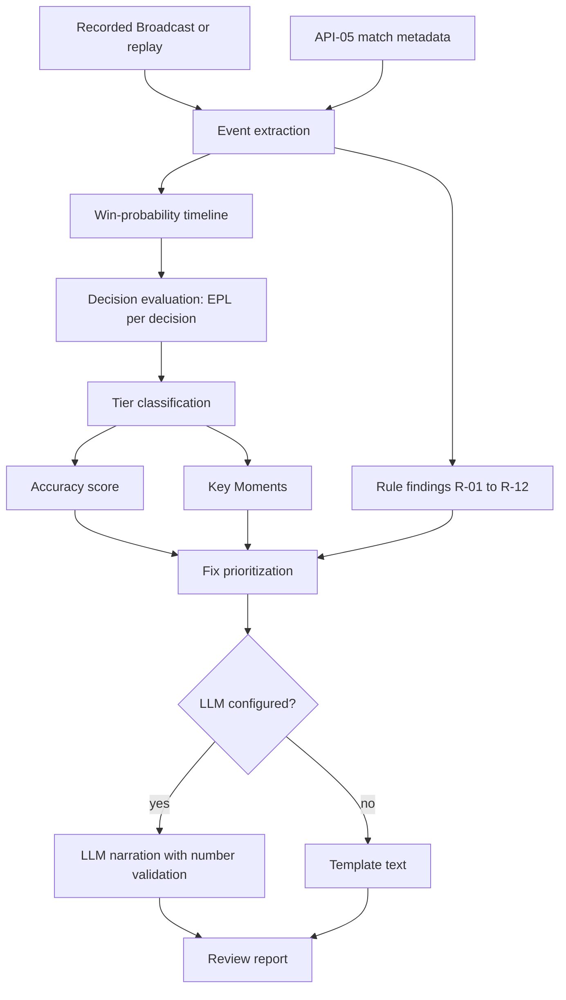

# 07 — Post-Match Review Engine

## Purpose

Specifies the post-match Review: a chess.com-style engine that scores the user's decisions from win-probability swings, uses rules wherever it can, and uses an LLM only for the explanations rules can't produce (DEC-011).

## Scope

- **Covers:** FR-REV-001 to FR-REV-017.
- **Mode:** Runs in Review Mode, so all match data may be used ([03](03-fair-play-and-compliance.md) FP-5).
- **Game mode:** Standard mode only (DEC-019). Other modes get no Review.

## Details

### Reference model

[chess.com's Game Review](https://support.chess.com/en/articles/8572705-how-are-moves-classified-what-is-a-blunder-or-brilliant-move) estimates each side's winning chances (0.00 to 1.00) and classifies each move by how many expected points it loses, from 0.00 for the best move to over 0.20 for a blunder. It adds rule-based special classes for critical moves, strong sacrifices and missed chances.

This engine does the same with three substitutions:

- A Deadlock win-probability model replaces the chess engine.
- Match decisions replace moves.
- Rules plus an LLM replace the coach.

### Pipeline

### Win-probability model

- **Form:** Logistic regression, `P(win | x) = σ(β · x)`. One model is trained on the last few patches and reused until its quality degrades (DEC-042).
- **Features, sampled every 30 s of game time:**

| Feature | Definition |
|---|---|
| `t` | Game time in minutes |
| `nw` | (Team net worth − enemy net worth) ÷ (team + enemy net worth) |
| `nw_t` | `nw × t` |
| `obj` | Objective difference, weighted 1 per guardian, 2 per walker, 3 per base objective [ASSUMPTION weights] |
| `alive` | (Team heroes alive − enemy heroes alive) ÷ 6 |

The feature set is trimmed to the features that both API-05 (for training) and the Broadcast (for Review) provide. T-009 checks API-05's fields (OQ-05). Any feature API-05 lacks is dropped before training, and the model file lists the features it actually uses.

- **Training:**
    - Data: at least 20,000 Standard matches pooled from the last 3 patches [ASSUMPTION], from API-05 per-interval stats [VERIFY interval and fields] (OQ-05).
    - Who: run offline by the developer on their own machine, at no cost.
    - Output: coefficients shipped as DATA-004. A single model file is loaded for every patch.
    - When: retrain only when the model's Brier score on recent matches rises above the quality bar. A new patch alone doesn't trigger retraining.
- **Quality bar:** Brier score ≤ 0.20 on held-out matches (SM-6). If the model was last trained on older patches than the match's, label the Review "Model from earlier patches".

### Decisions evaluated

Each decision gets an expected points lost (EPL) value between 0.00 and 1.00, from the user's team's perspective.

| Code | Decision | Window | EPL |
|---|---|---|---|
| D-DEATH | Each user death | From 5 s before death to respawn | `max(0, P(start) − P(end))`, attributed fully to the user |
| D-ITEM | Each user purchase | At purchase | `max(0, Score(best rec) − Score(item bought))`, using the [06](06-in-match-recommendations.md) Score rebuilt with full data |
| D-OBJ | Each objective taken or lost by either team | ±30 s | If the user was alive and absent: `max(0, −ΔP) × 1/6` |
| D-FARM | Each minute of game time | 60 s | `max(0, benchmark souls − user souls) × ∂P/∂nw`, evaluated at that minute |
| D-FIGHT | Each fight the user took part in (2+ heroes per side within 30 s) | Fight start to end | `max(0, −ΔP) × user's share of team damage dealt and taken` |

**Overlap rule (DEC-029):** One swing is counted once. When D-DEATH, D-FIGHT and D-OBJ windows overlap, the ΔP in the overlap goes to the highest-priority decision, in the order D-DEATH, D-FIGHT, D-OBJ. The lower-priority decision is evaluated only on its non-overlapping part. D-ITEM and D-FARM are separate groups and aren't deduplicated.

### Tiers (FR-REV-010)

Six tiers are set by EPL, mirroring chess.com's thresholds. Three special tiers override them when their rule fires. The order of evaluation is T7, T8, T9, then T1–T6.

| Tier | Rule |
|---|---|
| T1 | EPL = 0.00, and the decision was the best available (D-ITEM best rec bought; D-DEATH not applicable) |
| T2 | 0.00 < EPL ≤ 0.02 |
| T3 | 0.02 < EPL ≤ 0.05 |
| T4 | 0.05 < EPL ≤ 0.10 |
| T5 | 0.10 < EPL ≤ 0.20 |
| T6 | EPL > 0.20 |
| T7 (critical) | The team's P moved from < 0.40 to ≥ 0.50, or from 0.40–0.60 to ≥ 0.65, within the window, and the user's attributed share is ≥ 0.33 |
| T8 (risky and strong) | The user died in the window, but the team's P rose ≥ 0.10 across it (a trade that paid off) |
| T9 (missed opportunity) | Two or more enemies were dead, the user was alive, and the user dealt no hero or objective damage in the next 30 s |

All thresholds except T2–T6 are [ASSUMPTION].

> **[CREATIVE DECISION – AUTHOR TO FILL IN]**
> Topic: CD-07 — Names and icons for tiers T1–T9
> Constraints from the project: 9 names, each ≤ 12 characters to fit the review list. Icons are 9 SVGs on a 24×24 grid (AST-UI-001). Tiers must be distinguishable without color ([09](09-ui-window-and-overlay.md)). chess.com's own names are its branding, so don't copy them [ASSUMPTION].
> Options to consider (optional): —
> Decision: **Approved by the author (DEC-037):** T1 Spot On, T2 Solid, T3 Fine, T4 Slip, T5 Costly, T6 Disaster, T7 Clutch, T8 Gamble, T9 Missed Shot. Icon design is still open.

### Accuracy (FR-REV-011)

- **Formula:** `Accuracy = round(100 × exp(−10 × mean EPL))` [ASSUMPTION constant 10]. `mean EPL` is the average of the per-type mean EPLs (D-DEATH, D-ITEM, D-OBJ, D-FARM, D-FIGHT), taken over the types that have at least one decision. Each type counts equally (DEC-029).
- **Breakdown:** Also computed per phase: Lane (0–9 min), mid (9–20), late (20+).
- **Examples:** Mean EPL 0.00 gives 100; 0.02 gives 82; 0.05 gives 61; 0.10 gives 37.

### Key Moments (FR-REV-012)

- The 5 decisions with the largest `|ΔP|` attributed to the user, positive or negative.
- Each shows game time, decision type, tier, ΔP and the facts behind it.

### Rule findings

| ID | Condition (thresholds in DATA-001) | Finding |
|---|---|---|
| R-01 | Death while an escape or defensive ability or item was off cooldown and unused for ≥ 3 s before death | Unused cooldown at death (FR-REV-005) |
| R-02 | Soul deficit against lane opponents at 9:00 ≥ 1,500 [ASSUMPTION] | Lost lane (FR-REV-003) |
| R-03 | Neutral camp share of souls ≥ 15 percentage points below the rank benchmark | Under-farming camps (FR-REV-004) |
| R-04 | A core item bought ≥ 180 s after the rank median | Late core item |
| R-05 | A recommended counter item with Score ≥ 0.03 not bought for ≥ 180 s while affordable | Missed counter buy |
| R-06 | ≥ 40% of damage taken came from troopers or neutrals | Taking avoidable damage (FR-REV-006) |
| R-07 | Headshot rate ≥ 10 percentage points below the rank benchmark | Aim (FR-REV-007) |
| R-08 | ≥ 3 purchases outside the Build plan that weren't counter buys | Build deviation (FR-REV-008) |
| R-09 | For each counter buy: team P change in the 120 s after purchase, compared with the model's expected change | Counter buy paid off or didn't (FR-REV-008) |
| R-10 | Absent from ≥ 2 objective windows while alive | Objective presence |
| R-11 | Parry attempts with a success rate ≥ 20 percentage points below benchmark | Melee and parry (FR-REV-007) |
| R-12 | Ability upgrade order differs from the rank's most common order for the hero at the first 3 points | Ability order (FR-REV-009) |

### Fix prioritization (FR-REV-014)

1. Group the T4, T5 and T6 decisions and rule findings by cause (death, item, objective, farm).
2. Rank the groups by total EPL.
3. Output the top 1–3 fixes, each with its evidence: tier counts, EPL and the rule IDs that fired.

### LLM narration (FR-REV-013, FR-REV-015)

- **Used for:**
    - A 1–2 sentence explanation of each Key Moment.
    - Plain-language phrasing of each fix.
    - A 3-sentence summary per phase.
- **Not used for:** Any number, classification, ranking or recommendation. Rules compute all of those.
- **Input:** A JSON fact sheet ([11](11-data-model.md) `ReviewFacts`) plus a prompt template (DATA-005).
- **Validation:** Every number in the output must appear in the fact sheet. Any other number causes rejection, one retry, and then template text instead.
- **Providers (FR-SET-001):**

| Provider | Endpoint | Cost to developer |
|---|---|---|
| Off (default, DEC-030) | — | $0. Rules-only Review with template text |
| Local | OpenAI-compatible HTTP on `localhost`, for example an Ollama or llama.cpp server | $0 |
| Own API key | OpenAI-compatible or Anthropic API, key stored in the OS keyring | $0. The user pays their provider |

> **[CREATIVE DECISION – AUTHOR TO FILL IN]**
> Topic: CD-08 — Coach voice and tone for LLM text and template text
> Constraints from the project: Sentences ≤ 25 words. No invented numbers. Must work in rules-only template form too. Applies to DATA-005 prompts and DATA-006 templates.
> Options to consider (optional): —
> Decision: A friend who happens to be your coach, and always on your side (DEC-043). He gets properly excited when you pull off something cool, and sounds genuinely disappointed when you throw. After a match he either hypes you up or gives you a hard time, like a friend would. Casual spoken English in the second person, with contractions. The teasing is about the play, never about you, and every mistake ends with the fix and a sign he thinks you can do better. Excitement and disappointment scale with the tier: T1, T2, T7 and T8 get hype, T5, T6 and T9 get the ribbing, and T3 and T4 stay mild. No profanity [ASSUMPTION]. Sentences are 25 words or fewer. Numbers come only from the fact sheet. Template text keeps the same voice.

### Report contents

1. **Header:** Result, hero, duration, accuracy (overall and per phase), tier counts.
2. **Key Moments:** 5 entries.
3. **Top fixes:** 1–3 entries.
4. **Phase by phase:** Lane, mid, late (FR-REV-002), including the lane grade (FR-REV-003).
5. **Deaths:** One row per death (FR-REV-005).
6. **Souls:** Sources breakdown (FR-REV-004).
7. **Damage taken:** By source, plus mitigation (FR-REV-006).
8. **Aim and melee** (FR-REV-007).
9. **Build review:** Plan versus actual, and whether each counter buy paid off (FR-REV-008).
10. **Benchmarks** (FR-REV-009).
11. **Notes:** The user's notes on players from this match (FR-REV-017).

### Edge cases

| Case | Behavior |
|---|---|
| Match shorter than 10 min or abandoned | Stats only. No accuracy or tiers |
| Broadcast recording incomplete | Use the downloaded replay if present; otherwise produce a partial Review, labeled as such |
| Parser fails on a new patch | Retry with the .NET fallback parser (NFR-REL-002); otherwise stats-only Review from API-05 |
| Model trained on earlier patches only | Use it, labeled "Model from earlier patches" |

## Dependencies

- [03 Fair play](03-fair-play-and-compliance.md): FP-5.
- [04 Data sources](04-data-sources-and-ingestion.md): API-05, recordings.
- [06 In-match recommendations](06-in-match-recommendations.md): Score function.
- [11 Data model](11-data-model.md): `reviews`, `ReviewFacts`.
- [12 Programs](12-programs-and-code.md): PRG-15 to PRG-17.
- [13 Assets](13-art-and-asset-pipeline.md): AST-UI-001.
- [14 Data assets](14-data-and-content-assets.md): DATA-001, DATA-004, DATA-005, DATA-006.

## Open Questions

- OQ-05: Do API-05 stats come per minute, per 5 minutes or per tick, and do they include net worth and objectives?
- OQ-15 (resolved): No. Standard mode only (DEC-019).
- OQ-11 (resolved): The default is Off (DEC-030).
- [ASSUMPTION] Model features and objective weights, T1 and T7–T9 rules, the accuracy constant, all R-xx thresholds.

## Acceptance Criteria

- [ ] The model meets SM-6 on a held-out set of 2,000 matches (TST-061).
- [ ] The same match produces the same tiers, accuracy and fixes on every run (TST-068).
- [ ] With the LLM Off, a complete Review renders with template text (TST-0691).
- [ ] An LLM response containing a number not in the fact sheet is rejected (TST-069).
- [ ] The rules-based Review is ready ≤ 60 s after the Broadcast ends (NFR-PERF-004).
