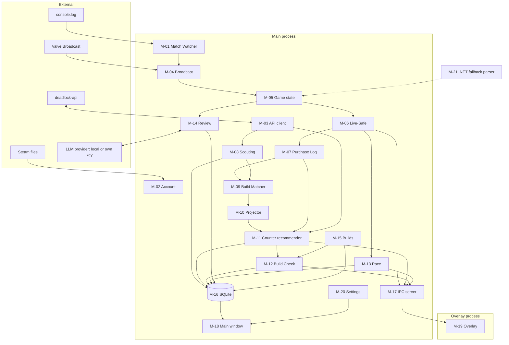
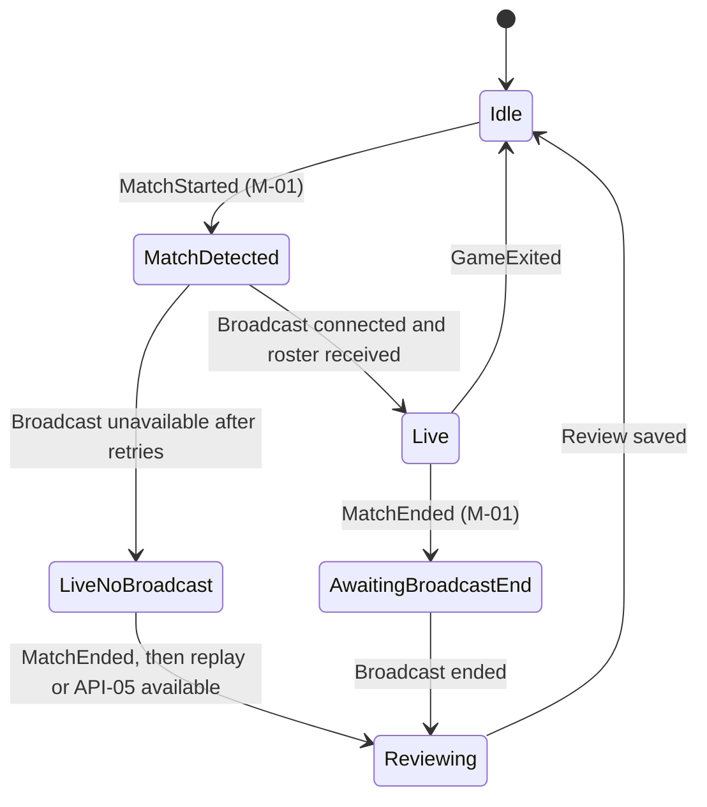

# 10 — Technical Architecture

## Purpose

Defines the technology stack, modules, process model, data flow, IPC and repository layout.

## Scope

- **Covers:** All runtime software and developer tools.
- **Elsewhere:** Database schema in [11](11-data-model.md); per-program detail in [12](12-programs-and-code.md).

## Details

### Stack decision (DEC-008)

The user prefers a Rust + .NET combination, or Rust alone if one must be chosen. haste parses both Deadlock replays and live HTTP broadcasts in Rust, so the core is pure Rust. .NET appears only as an optional fallback parser (M-21) for when haste breaks after a game patch.

| Layer | Choice | Purpose | License |
|---|---|---|---|
| Language | Rust (stable) | All app code | — |
| Async runtime | `tokio` | I/O, timers, tasks | MIT |
| HTTP | `reqwest` (rustls) | deadlock-api, LLM providers | MIT/Apache-2.0 |
| Rate limiting | `governor` | Token buckets per limit scope | MIT |
| Serialization | `serde`, `serde_json`, `toml` | API, IPC, config | MIT/Apache-2.0 |
| Database | `rusqlite` (bundled SQLite) | Local storage | MIT |
| File watching | `notify` | Tailing `console.log` | CC0/Artistic-2.0 |
| VDF parsing | `keyvalues-parser` [ASSUMPTION crate choice] | `loginusers.vdf`, `libraryfolders.vdf` | MIT |
| Demo and broadcast parsing | [`haste`](https://awesome.ecosyste.ms/projects/github.com%2Fblukai%2Fhaste) with `broadcast` feature | Broadcast and replays | BSD-3-Clause |
| Fallback parser | [DemoFile](https://nuget.org/packages/DemoFile) (.NET) in a sidecar | Resilience after patches | [VERIFY license; must be GPL-3.0 compatible] |
| UI | `slint` | Main window and overlay UI | GPLv3. The app is licensed GPL-3.0 (DEC-020) |
| Linux overlay surface | `smithay-client-toolkit` layer surface rendering Slint (DEC-055). `layer-shika` is not used: it's AGPL-3.0-or-later | Overlay on KDE Plasma Wayland | MIT |
| Windows overlay | `windows` crate (Win32 extended styles, `RegisterHotKey`) | Overlay on Windows | MIT/Apache-2.0 |
| Portals | `ashpd` | GlobalShortcuts, FileChooser on Linux | MIT |
| Secrets | `oo7` (Linux, Secret portal), `keyring` (Windows Credential Manager) [ASSUMPTION] | Own API keys | MIT |
| Logging | `tracing`, `tracing-subscriber` | Logs | MIT |
| Errors | `thiserror`, `anyhow` | Error types | MIT/Apache-2.0 |

The overlay uses a direct `smithay-client-toolkit` layer surface with a Slint software renderer (DEC-055). `layer-shika` was the earlier choice, but it's early-stage (RSK-05) and AGPL-3.0-or-later.

### Modules

| ID | Module | Responsibility | Program |
|---|---|---|---|
| M-01 | `match_watcher` | Tail `console.log`; emit match events | PRG-01 |
| M-02 | `account` | Find Steam roots, libraries and the user's Account ID | PRG-02 |
| M-03 | `api_client` | deadlock-api calls, rate limits, caching | PRG-03 |
| M-04 | `broadcast` | Connect, parse, record, reconnect | PRG-04 |
| M-05 | `game_state` | Normalized match state from parser events | PRG-05 |
| M-06 | `live_safe` | Whitelist projection of game state in Live Mode | PRG-06 |
| M-07 | `purchase_log` | Inventory diffs into purchase events | PRG-07 |
| M-08 | `scouting` | Scouting Cards and the Counter-buy filter | PRG-08, PRG-09 |
| M-09 | `build_matcher` | Bayesian build detection | PRG-10 |
| M-10 | `projector` | Next-3-items projection | PRG-11 |
| M-11 | `counter_recommender` | Counter-item scoring and team comp prediction | PRG-12 |
| M-12 | `build_check` | Swap suggestions for the Build plan | PRG-13 |
| M-13 | `pace` | Farm pace, item timing, flex slots, timers | PRG-14 |
| M-14 | `review` | Win-probability model, evaluation, tiers, rules, LLM narration | PRG-15, PRG-16, PRG-17 |
| M-15 | `builds` | Build library, manual builder, importers | PRG-18, PRG-19 |
| M-16 | `storage` | SQLite access and migrations | PRG-23 |
| M-17 | `ipc` | Messages between the app and overlay processes | PRG-24 |
| M-18 | `app` (binary) | Main window | PRG-20 |
| M-19 | `overlay` (binary) | Overlay process | PRG-22 |
| M-20 | `settings` | Config files and secrets | PRG-25 |
| M-21 | `fallback-parser` (.NET) | DemoFile-based parser emitting the same normalized events | PRG-21 |

Developer-only tools: PRG-26 model trainer, PRG-27 fixture recorder ([12](12-programs-and-code.md)).

### Process model

| Process | Binary | Contains |
|---|---|---|
| Main | `stalemate` | Core library (M-01 to M-17, M-20) and main window (M-18) |
| Overlay | `stalemate-overlay` | Overlay renderer (M-19). Started and stopped by the main process |
| Fallback parser (optional) | `stalemate-parser-fallback` | M-21. Started only when haste fails |

The overlay runs as its own process so its Wayland layer-shell event loop is isolated from the main window's, and an overlay crash can't take down the core [ASSUMPTION].

### Component diagram



### App state machine



Live Mode covers `MatchDetected`, `Live`, `LiveNoBroadcast` and `AwaitingBroadcastEnd`. Review Mode is `Reviewing`. The Live-Safe filter (M-06) is active in every Live Mode state.

### Concurrency

- One tokio runtime in the main process.
- Each source (M-01, M-04) runs as a task that sends events into an `mpsc` channel consumed by the game state actor (M-05).
- Derived modules (M-07 to M-13) subscribe to a `tokio::sync::watch` of the Live-Safe state.
- UI updates go to Slint through `slint::invoke_from_event_loop`.

### IPC (M-17)

- **Linux:** Unix domain socket at `$XDG_RUNTIME_DIR/io.github.hatchbear.stalemate/overlay.sock`.
- **Windows:** Named pipe `\\.\pipe\stalemate-overlay`.
- **Framing:** Newline-delimited JSON. Schema in [11](11-data-model.md) (`OverlayMessage`).
- **Direction:** Main to overlay for updates and visibility; overlay to main for acknowledgments, hotkey events and errors.
- **Rule:** The main process builds overlay payloads only from M-06 output (NFR-FAIR-003).

### File locations

| Data | Linux Flatpak | Windows |
|---|---|---|
| Config | `~/.var/app/io.github.hatchbear.stalemate/config/stalemate/` | `%APPDATA%\stalemate\` |
| Database, recordings, caches | `~/.var/app/io.github.hatchbear.stalemate/data/stalemate/` | `%LOCALAPPDATA%\stalemate\` |
| Logs | `~/.var/app/io.github.hatchbear.stalemate/data/stalemate/logs/` | `%LOCALAPPDATA%\stalemate\logs\` |
| Secrets | Secret portal | Windows Credential Manager |

### Repository layout

```text
/
├── Cargo.toml                    # workspace
├── crates/
│   ├── core/                     # library: M-01 to M-17, M-20
│   │   └── src/
│   │       ├── match_watcher.rs  # M-01
│   │       ├── account.rs        # M-02
│   │       ├── api_client/       # M-03
│   │       ├── broadcast/        # M-04
│   │       ├── game_state.rs     # M-05
│   │       ├── live_safe.rs      # M-06
│   │       ├── purchase_log.rs   # M-07
│   │       ├── scouting/         # M-08
│   │       ├── build_matcher.rs  # M-09
│   │       ├── projector.rs      # M-10
│   │       ├── counter.rs        # M-11
│   │       ├── build_check.rs    # M-12
│   │       ├── pace.rs           # M-13
│   │       ├── review/           # M-14
│   │       ├── builds/           # M-15
│   │       ├── storage/          # M-16
│   │       ├── ipc.rs            # M-17
│   │       └── settings.rs       # M-20
│   ├── app/                      # binary: main window (M-18)
│   ├── overlay/                  # binary: overlay (M-19)
│   ├── model-trainer/            # binary, dev only (PRG-26)
│   └── fixture-recorder/         # binary, dev only (PRG-27)
├── dotnet/
│   └── fallback-parser/          # M-21
├── ui/                           # .slint files
├── config/                       # DATA-001, DATA-002, DATA-003 defaults
├── models/                       # DATA-004
├── prompts/                      # DATA-005
├── i18n/                         # DATA-006
├── assets/                       # AST-* (see 13)
├── packaging/
│   ├── flatpak/
│   └── windows/
├── tests/
│   └── fixtures/                 # DATA-008
└── docs/                         # this doc set
```

## Dependencies

- [03 Fair play](03-fair-play-and-compliance.md)
- [04](04-data-sources-and-ingestion.md)–[09](09-ui-window-and-overlay.md): system designs.
- [11 Data model](11-data-model.md)
- [12 Programs](12-programs-and-code.md)
- [15 Tools and deploy](15-tools-build-and-deploy.md)

## Open Questions

- RSK-05: Does KWin keep a `smithay-client-toolkit` layer surface above the game? (layer-shika dropped, DEC-055.)
- OQ-12 (resolved): DemoFile is MIT. layer-shika is AGPL-3.0-or-later, so it isn't used (DEC-055). Slint is used under GPLv3 (DEC-020). haste's dependency `mars` has no licence (DEC-049).
- [ASSUMPTION] Separate overlay process, VDF crate choice, secrets crates.

## Acceptance Criteria

- [ ] Every module M-01 to M-21 maps to at least one requirement in [02](02-requirements.md) and one program in [12](12-programs-and-code.md).
- [ ] The workspace builds on Linux (Flatpak SDK) and Windows (MSVC) in CI ([15](15-tools-build-and-deploy.md)).
- [ ] No module outside M-06 sends game state to M-17 or M-18 in Live Mode (code review plus TST-030).
