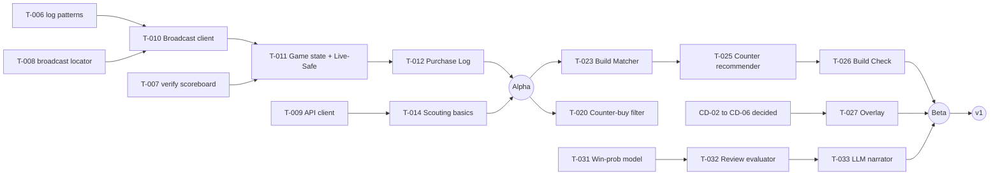

# 17 — Roadmap

## Purpose

Breaks the work into Alpha, Beta and v1 milestones (DEC-012), with tasks, dependencies, rough effort and exit criteria.

## Scope

- **Covers:** All work from an empty repository to the v1 release.
- **Dates:** None were set in the conversation, so this roadmap uses effort only.
- **Effort:** Person-days for one developer [ASSUMPTION].

## Details

### Milestone goals

| Milestone | Goal | Platforms |
|---|---|---|
| **Alpha** | Prove the data pipeline end to end: match detected, Broadcast consumed and recorded, basic scouting, enemy board and Purchase Log, stats-only Review, build import and manual builder. Main window only | Flatpak on KDE Plasma 6 Wayland |
| **Beta** | All core intelligence: Build Profiles with the Counter-buy filter, Build Matcher, Projector, phase-aware counter items, Build Check, the overlay, and the chess.com-style Review with rules and LLM | Flatpak on KDE Plasma; Windows 11 |
| **v1** | Everything else in [02](02-requirements.md), final art, privacy policy, Flathub stable | Plus Windows 10; best effort on other Linux desktops |

### Dependency overview

### Alpha tasks

| ID    | Task                                                                                                                                                                                                                          | Depends on   | Effort | Requirements                            |
| ----- | ----------------------------------------------------------------------------------------------------------------------------------------------------------------------------------------------------------------------------- | ------------ | ------ | --------------------------------------- |
| T-001 | Workspace, CI skeleton, `justfile`                                                                                                                                                                                            | —            | 2      | —                                       |
| T-002 | Storage and migrations (PRG-23)                                                                                                                                                                                               | T-001        | 2      | TST-105                                 |
| T-003 | Settings and secrets (PRG-25)                                                                                                                                                                                                 | T-001        | 2      | —                                       |
| T-004 | Flatpak manifest; build and run on KDE Plasma; measure the size impact of bundling the .NET fallback                                                                                                                          | T-001        | 3      | NFR-PLAT-001                            |
| T-005 | Account resolver (PRG-02)                                                                                                                                                                                                     | T-001        | 2      | FR-DATA-006, NFR-PLAT-002               |
| T-006 | Capture `console.log` patterns from real matches; Match Watcher (PRG-01)                                                                                                                                                      | T-005        | 3      | FR-DATA-001, FR-DATA-002 (OQ-03)        |
| T-007 | Verify Live-Safe scoreboard fields in-game; fill DATA-003. Also verify that the pre-game hero-swap phase closes before scouting is shown (FP-10)                                                                              | —            | 1      | OQ-04                                   |
| T-008 | Spike and hard go/no-go gate (DEC-021): find a compliant broadcast locator and confirm the Broadcast roster carries Account IDs. If it fails, Alpha ships with API scouting, manual roster entry and a post-match Review only | —            | 3      | OQ-02, RSK-11                           |
| T-009 | API client (PRG-03) and asset cache; verify API-05 fields and API-16 path                                                                                                                                                     | T-002        | 4      | FR-DATA-004, FR-DATA-008 (OQ-05, OQ-07) |
| T-010 | Broadcast client with haste and recording (PRG-04)                                                                                                                                                                            | T-006, T-008 | 6      | FR-DATA-003, FR-DATA-005                |
| T-011 | Game state (PRG-05) and Live-Safe filter (PRG-06)                                                                                                                                                                             | T-007, T-010 | 4      | NFR-FAIR-003                            |
| T-012 | Purchase Log (PRG-07)                                                                                                                                                                                                         | T-011        | 2      | FR-LIVE-002                             |
| T-013 | Fixture recorder (PRG-27); record 20 own matches                                                                                                                                                                              | T-010        | 3      | DATA-008                                |
| T-014 | Scouting basics: W/L, MMR, mains, hero experience (PRG-08)                                                                                                                                                                    | T-009        | 4      | FR-SCOUT-001 to 004, 015                |
| T-015 | In-game build import, manual builder, active plan (PRG-18, PRG-19)                                                                                                                                                            | T-009        | 5      | FR-BUILD-001, 003, 005                  |
| T-016 | Stats-only Review: match record, lane grade, soul sources                                                                                                                                                                     | T-013        | 4      | FR-REV-001, 003, 004                    |
| T-017 | Main window: Home, Scouting, Live (enemy board, Purchase Log), Reviews, Builds, Settings (PRG-20)                                                                                                                             | T-012, T-014 | 6      | FR-UI-001, FR-LIVE-001                  |
| T-018 | First-run setup for `-condebug`                                                                                                                                                                                               | T-006        | 2      | FR-SET-003                              |
| T-019 | Alpha QA and release                                                                                                                                                                                                          | All above    | 3      | [16](16-testing-and-qa.md)              |
|       | **Alpha total**                                                                                                                                                                                                               |              | **61** |                                         |

### Beta tasks

| ID | Task | Depends on | Effort | Requirements |
|---|---|---|---|---|
| T-020 | Build Profile and Counter-buy filter (PRG-09); hand-label 30 profiles | Alpha | 4 | FR-SCOUT-005, 006 |
| T-021 | Power spikes and playstyle | Alpha | 4 | FR-SCOUT-007, 008 |
| T-022 | User matchups (API-09, API-10); manual roster entry when the Broadcast is unavailable | Alpha | 2 | FR-SCOUT-011, FR-DATA-007 |
| T-023 | Build Matcher (PRG-10); label 100 matches at 15:00 | T-012 | 5 | FR-LIVE-003 |
| T-024 | Projector (PRG-11) | T-023 | 2 | FR-LIVE-004 |
| T-025 | Counter recommender and recommendation history (PRG-12) | T-023 | 5 | FR-LIVE-005 to 008, 014, FR-UI-006 |
| T-026 | Build Check (PRG-13); read the selected build from the Broadcast | T-025 | 2 | FR-LIVE-009, FR-BUILD-004 |
| T-027 | Overlay on KDE (PRG-22) and IPC (PRG-24) | CD-02 to CD-06, T-025 | 8 | FR-UI-002 to 004, 007, 008 |
| T-028 | Windows port: paths, Win32 overlay, MSI | T-027 | 8 | FR-UI-005, NFR-PLAT-003 |
| T-029 | .NET fallback parser (PRG-21) | T-013 | 5 | NFR-REL-002 |
| T-030 | Asset pipeline and placeholders (`just export-assets`) | T-001 | 2 | TST-110 |
| T-031 | Win-probability model (PRG-15) and trainer (PRG-26) | T-009 | 6 | SM-6 |
| T-032 | Review evaluator: decisions, tiers, accuracy, Key Moments, R-01 to R-06 and R-08 to R-10 (PRG-16) | T-031, T-016 | 8 | FR-REV-002, 005, 006, 008, 010 to 012, 014 |
| T-033 | LLM narrator, providers and DATA-005 (PRG-17) | T-032, CD-08 | 4 | FR-REV-013, 015, FR-SET-001 |
| T-034 | Review report UI | T-032 | 4 | FR-REV-002 to 014 |
| T-035 | Patch-change flagging for builds | T-015 | 1 | FR-BUILD-006 |
| T-036 | Beta QA, field testing, release | All above | 5 | [16](16-testing-and-qa.md) |
| T-037 | Replay download fallback (API-17) | T-008, T-009 | 3 | FR-DATA-009 |
| T-038 | Update check against GitHub Releases | T-003 | 1 | FR-SET-004 |
| T-039 | Team comp prediction (API-18 or fallback) | T-009, T-025 | 2 | FR-LIVE-016 |
| | **Beta total** | | **81** | |

### v1 tasks

| ID | Task | Depends on | Effort | Requirements |
|---|---|---|---|---|
| T-040 | Flags, notes, repeat players, session check; Players view | Beta | 4 | FR-SCOUT-009, 010, 012, 013, FR-REV-017, FR-UI-001 (Players view) |
| T-041 | Pace and item timing | Beta | 2 | FR-LIVE-010, 011 |
| T-042 | Flex slots and timers (DATA-002) | OQ-09 | 3 | FR-LIVE-012, 013 |
| T-043 | Aim and melee (R-07, R-11), benchmarks (R-12) | Beta | 4 | FR-REV-007, 009 |
| T-044 | Long-term trends | Beta | 3 | FR-REV-016 |
| T-045 | External build importers (Should; JSON and share-code import first) | OQ-06 | 5 | FR-BUILD-002 |
| T-046 | Match-level ban rates (Could) | OQ-08 | 1 | FR-SCOUT-016 |
| T-047 | Data export and delete | Beta | 2 | FR-SET-002 |
| T-048 | Privacy policy, About and disclaimer; policy hosted on GitHub Pages [ASSUMPTION] | — | 1 | NFR-PRIV-002, FP-9 |
| T-049 | Final art integration | CD-07, CD-10, CD-11 | 3 | [13](13-art-and-asset-pipeline.md) |
| T-050 | Dropped from v1: Upkeep decision and legal review (DEC-018) | — | — | DEC-009 |
| T-051 | Windows 10 and other-desktop testing | T-028 | 2 | NFR-PLAT-004 |
| T-052 | Flathub stable submission | T-048, T-049 | 2 | [15](15-tools-build-and-deploy.md) |
| T-053 | v1 QA and release | All above | 5 | [16](16-testing-and-qa.md) |
| T-054 | UI navigation sounds (AUD-002) | CD-12 | 1 | FR-UI-009 |
| | **v1 total** | | **38** | |

**Tasks only the author can do (DEC-044):** T-006, T-007, T-013, the hand-labeling in T-020 and T-023, and supplying reference screenshots of the in-game UI (kept out of the repository). The AI team waits on these.

**Overall estimate:** about 180 person-days (61 Alpha, 81 Beta, 38 v1), plus a 30% contingency, for about 234 [ASSUMPTION] (DEC-034). No target dates are set; this roadmap uses effort only.

### Exit criteria

| Milestone | Exit when |
|---|---|
| Alpha | All Alpha-phase Must requirements pass their TSTs on KDE Plasma (native and Flatpak Steam); TST-030 passes on 20 fixtures; OQ-02, OQ-03, OQ-04 and OQ-05 resolved |
| Beta | All Beta-phase Must requirements pass; SM-3 to SM-8 met; overlay passes TST-090 and TST-091; 2 weeks of field testing with no open S1 bugs |
| v1 | Every Must and Should requirement passes; no placeholders (TST-110); privacy policy live; Flathub stable published |

## Dependencies

- [02 Requirements](02-requirements.md): phase per requirement.
- [12 Programs](12-programs-and-code.md)
- [16 Testing](16-testing-and-qa.md)
- [18 Risks](18-risks-and-open-questions.md)

## Open Questions

- Target dates: none, effort only (DEC-034).
- [ASSUMPTION] All effort estimates, assuming one developer.

## Acceptance Criteria

- [ ] Every Must requirement in [02](02-requirements.md) is covered by at least one task.
- [ ] Every task names its dependencies and requirements.
- [ ] The author has approved the milestone split.
