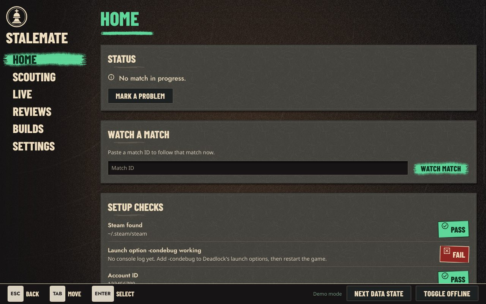
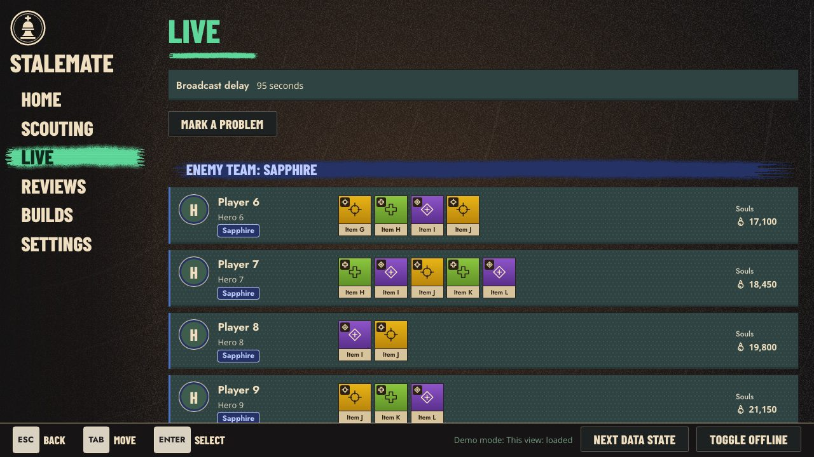
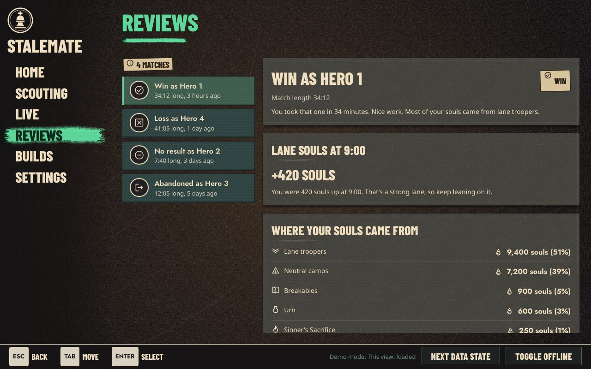
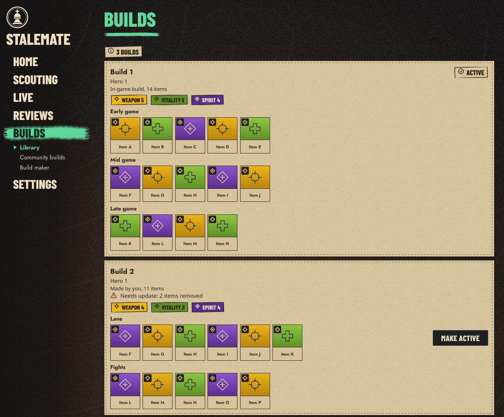

# Stalemate

A free companion app for Valve's *Deadlock*. It scouts the players in your match, follows the enemy team's items while you play, and reviews your match when it ends.

**Status: closed Alpha.** Builds go to invited testers for Linux and Windows. A public release follows once licensing for one dependency is settled.

**[Read the tester guide →](https://hatchbear.github.io/Stalemate/)** It covers installing, setting up and every feature to try.

Stalemate is not made by, affiliated with or endorsed by Valve.



## What you can do in the Alpha

| | |
|---|---|
| **Automatic match detection** | Stalemate notices when your match starts and ends from the game's own log. No buttons to press. You can also paste a match ID to follow any match |
| **Scouting** | A card for every player: overall record, last 20 matches, rank, top heroes and games on their current hero. Players who opted out of public data show "No public data" |
| **Live enemy board** | Each enemy's items, as tiles in the shop's category colours, and their souls. It shows only what the in-game scoreboard would show you, with the broadcast delay stated on screen |
| **Purchase log** | Buys, upgrades and sells as they happen |
| **Match reviews** | Win or loss, your lane souls at 9:00, and where your souls came from. Abandoned matches and matches with no result are labelled as such |
| **Builds** | Import the game's community builds, keep a library, and make your own with the build maker |
| **Diagnostics file** | Mark a problem when it happens, then save one file to send. Nothing is ever uploaded by the app |







## Platforms

| System | Packages |
|---|---|
| Linux | Flatpak (any distribution), `.deb` (Debian 12+, Ubuntu 22.04+), `.rpm` (Fedora, openSUSE), AppImage, tarball. Finds both normal Steam and Flatpak Steam |
| Windows 11 | MSI installer (per user, no admin rights) and a portable zip |

Alpha builds aren't code-signed yet, so Windows shows a SmartScreen warning the first time.

## Fair play

Stalemate follows Valve's rules strictly. It never:

- reads or writes the game's memory, injects code, hooks graphics or captures network traffic;
- sends keyboard or mouse input to the game, or automates anything in it;
- shows anything during a match that the game itself wouldn't show you;
- shows chat;
- looks up players who opted out of public data, or calls the Steam Web API for other players.

These rules are checked automatically on every change, including a scan of the built programs.

**Where the data comes from:** the game's own log file (with the `-condebug` launch option), the public [deadlock-api.com](https://deadlock-api.com), and the match's public, delayed spectator broadcast. Every install talks to these directly. There's no Stalemate server and nothing to pay for.

## Build from source

You need Rust 1.98.1 (pinned in `rust-toolchain.toml`) and `protoc` (the protobuf compiler).

```
cargo run -p stalemate-app --bin stalemate -- --demo
```

`--demo` runs the app on made-up data, so you can try every screen without the game.

## Licence

GPL-3.0. See [LICENSE](LICENSE).
